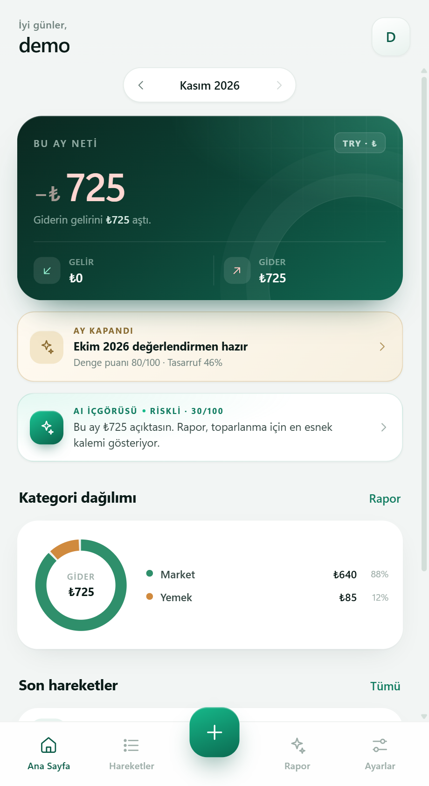

# Denge — Aylık Gelir & Gider

Gelirini ve giderini tek ekranda takip et. Ay sonunda Denge, harcamalarını okuyup sana özel bir değerlendirme sunar.

**Windows için tek dosya uygulama.** Kurulum yok, bulut hesabı yok, veriler cihazında kalır.

---

## ⬇️ İndir

### **[En son sürümü indir](https://github.com/muzbuba10-svg/denge-indir/releases/latest)**

İndirdikten sonra `Denge.exe` dosyasına çift tıkla. Başka bir şey kurmana gerek yok.

> İlk açılışta Windows "Bilinmeyen yayıncı" uyarısı gösterebilir (uygulama kod imzalı değil).
> **Ek bilgi → Yine de çalıştır** ile devam edebilirsin.

### Gereksinimler

- Windows 10 veya 11
- Microsoft Edge WebView2 Runtime (Windows 11'de hazır gelir; Windows 10'da genellikle Edge ile birlikte kuruludur)

---

## Neler yapabilirsin?

| Alan | Özellik |
| --- | --- |
| Hesap | Yerel kullanıcı hesabı, PBKDF2 ile korunan şifre, otomatik kilit |
| Ana sayfa | Ay seçici, gelir/gider/net özeti, kategori dağılımı, son hareketler |
| Hareketler | Ekleme, düzenleme, silme, ay ve tür filtresi, arama |
| Rapor | 0–100 denge puanı, tasarruf oranı, günlük ortalama, önceki ayla karşılaştırma, öneriler |
| Yedek | AES-GCM-256 ile şifreli `.denge` dosyası, geri yükleme, CSV dışa aktarma |
| Masaüstü | Kendi penceresi, yerel kaydetme penceresi, tek örnek kilidi |

Demo hesabı denemek için giriş ekranındaki **Demo ile keşfet** butonunu kullanabilirsin (`demo` / `demo1234`).

## Gizlilik

- Veriler yalnızca bu bilgisayarda, `%LOCALAPPDATA%\Denge` altında tutulur.
- Bulut hesabı, reklam, analitik veya dışarıya veri gönderimi yoktur.
- "Akıllı değerlendirme" cihazda çalışan kural tabanlı bir motordur; gerçek bir yapay zekâ servisi kullanmaz.
- Uygulama yatırım veya finansal danışmanlık sunmaz.

## Sürüm notları

Sürüm notları ve eski sürümler için [Releases](https://github.com/muzbuba10-svg/denge-indir/releases) bölümüne bak.

---

© 2026 Denge · MIT License
